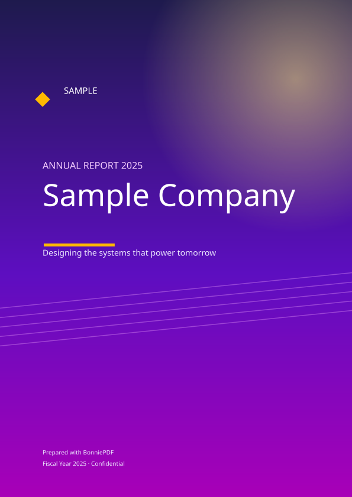
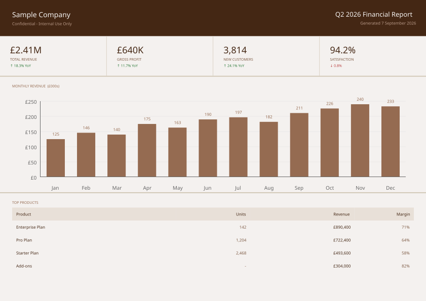
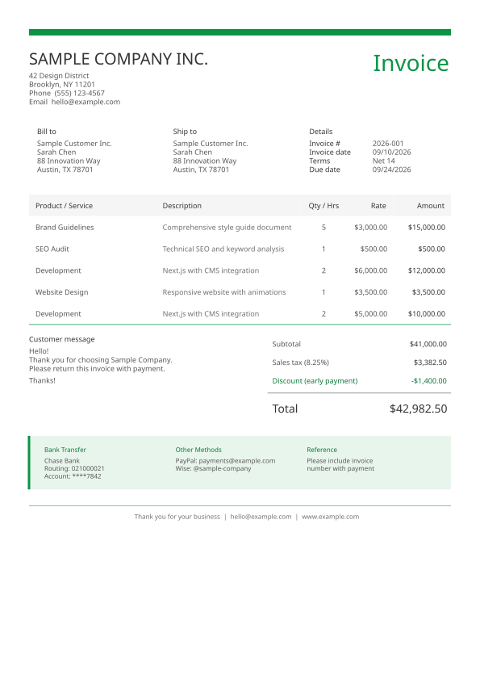
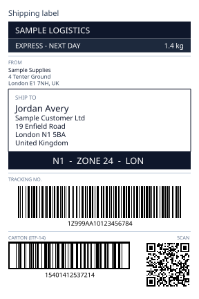
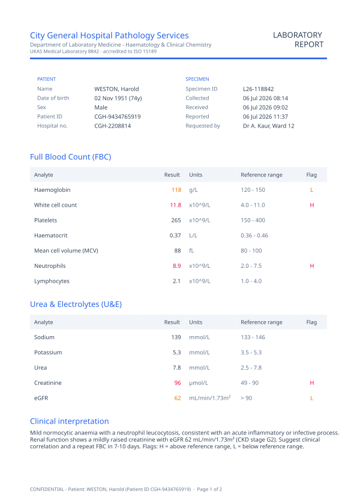
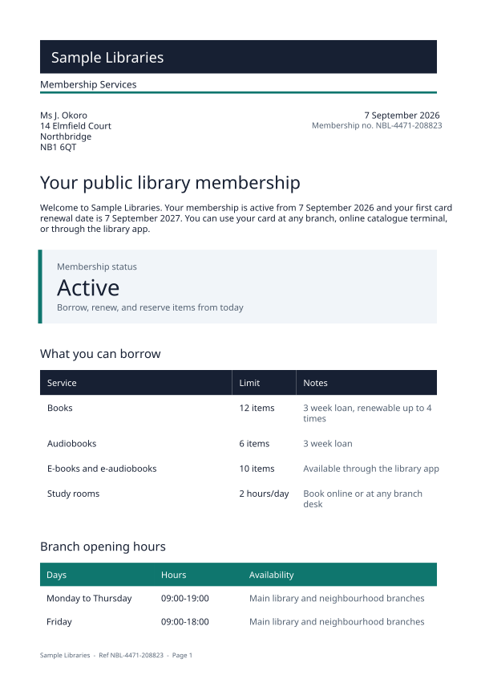

# BonniePDF for TypeScript and JavaScript

[](https://www.npmjs.com/package/@bonniepdf/core)
[](https://www.npmjs.com/package/@bonniepdf/core)
[](./core/LICENSE)
[](https://bundlephobia.com/package/@bonniepdf/core)


[Live examples](https://www.bonniepdf.dev/examples) · [Documentation](https://www.bonniepdf.dev/docs/typescript/getting-started) · [npm](https://www.npmjs.com/package/@bonniepdf/core) · [.NET package](https://www.nuget.org/packages/BonniePDF)

Create polished, accessible and archival-ready PDFs directly from TypeScript and JavaScript. BonniePDF is a pure TypeScript document engine with automatic layout and pagination, vector charts, embedded fonts, PDF/UA tagging and PDF/A conformance. It runs in browsers, Node.js, Bun, Deno and edge runtimes with zero dependencies—and requires no Chromium, headless browser, canvas library, native add-ons or print server.

BonniePDF creates new PDFs from code. It is not an HTML converter, PDF parser, form filler or editor for existing files.

## What you can build

<table>
  <tr>
    <td width="33%" align="center">
      <a href="https://www.bonniepdf.dev/examples/reports/annual-report-masked-cover">
        
      </a>
    </td>
    <td width="33%" align="center">
      <a href="https://www.bonniepdf.dev/examples/reports/financial-dashboard">
        
      </a>
    </td>
    <td width="33%" align="center">
      <a href="https://www.bonniepdf.dev/examples/invoices/business-invoice">
        
      </a>
    </td>
  </tr>
  <tr>
    <td align="center"><strong>Annual reports</strong><br />Photography, clipping masks and vector composition</td>
    <td align="center"><strong>Executive dashboards</strong><br />KPIs, charts and data-rich tables</td>
    <td align="center"><strong>Business documents</strong><br />Automatic layout, flow and pagination</td>
  </tr>
  <tr>
    <td width="33%" align="center">
      <a href="https://www.bonniepdf.dev/examples/operations/shipping-label">
        
      </a>
    </td>
    <td width="33%" align="center">
      <a href="https://www.bonniepdf.dev/examples/healthcare/lab-report">
        
      </a>
    </td>
    <td width="33%" align="center">
      <a href="https://www.bonniepdf.dev/examples/community/public-library-membership-letter">
        
      </a>
    </td>
  </tr>
  <tr>
    <td align="center"><strong>Shipping labels</strong><br />Barcodes, QR codes and precision page sizing</td>
    <td align="center"><strong>Clinical reports</strong><br />Structured clinical data and accessible tables</td>
    <td align="center"><strong>Public-service letters</strong><br />Multi-page typography and branded layouts</td>
  </tr>
</table>

Every example is generated by BonniePDF. Explore the complete [live example gallery](https://www.bonniepdf.dev/examples) with source code for both TypeScript and .NET.

## Why BonniePDF

- **Runs where JavaScript runs.** Generate on the client, on a server, in Bun or Deno, or inside an edge worker.
- **Zero runtime dependencies.** No Chromium, WASM generation engine, `node-canvas`, native binary or remote rendering service.
- **Automatic document layout.** Compose pages from text, containers, rows, tables, lists, images and charts; BonniePDF measures, flows and paginates them.
- **Accessibility built in.** Produce tagged PDF/UA-1 documents with semantic headings, paragraphs, tables, lists, figures and alternative text.
- **Archival output.** Generate PDF/A-1, PDF/A-2, PDF/A-3 and PDF/A-4 documents with the required metadata, colour profiles and font handling.
- **Production features.** AES-256 encryption, attachments, vector charts, embedded fonts, Unicode, barcodes, QR codes and SVG page export.
- **Cross-language parity.** The TypeScript and .NET packages are co-equal implementations of the same language-neutral BonniePDF specification.

## Install

```bash
npm install @bonniepdf/core
```

pnpm, Bun and Yarn work too. The package ships ESM and CommonJS entry points and has no runtime dependencies.

## Quick start

```typescript
import {
  AccessibilityMode,
  ColorPalette,
  Document,
  Heading,
  PdfAConformance,
  StandardFonts,
  TextBlock,
} from '@bonniepdf/core';

const document = new Document();

document.metadata.title = 'Quarterly report';
document.metadata.author = 'Northwind Analytics';
document.settings.conformance = PdfAConformance.PdfA2a;
document.settings.accessibility = AccessibilityMode.PdfUa1;
document.settings.language = 'en-GB';

const title = new Heading('Quarterly report');
title.level = 1;
title.fontName = StandardFonts.HelveticaBold;
title.fontSize = 24;
title.textColor = ColorPalette.slate[800];
document.add(title);

document.add(new TextBlock('Generated as an accessible, archival PDF with no server required.'));

const bytes: Uint8Array = await document.generateBytesAsync();
```

Open or download the result in a browser:

```typescript
const url = URL.createObjectURL(new Blob([bytes], { type: 'application/pdf' }));
window.open(url, '_blank');
```

Write it to disk in Node.js:

```typescript
import { writeFile } from 'node:fs/promises';

await writeFile('quarterly-report.pdf', bytes);
```

A `Document` starts with its first page ready to use. Add elements in reading order; call `addPage()` to start another page, or let flowing elements paginate themselves.

## Capabilities

| Area                  | Included                                                                                                                                  |
| --------------------- | ----------------------------------------------------------------------------------------------------------------------------------------- |
| Layout                | Automatic page flow, stacks, weighted rows, grids, containers, layers, clipping, rounded corners, headers, footers and page backgrounds   |
| Text                  | Standard PDF fonts, embedded TrueType/OpenType fonts with subsetting, Unicode, emoji, rich text, alignment, decoration and fallback fonts |
| Tables and lists      | Weighted columns, styled cells, repeating headers, ordered/unordered lists and nested content                                             |
| Charts                | Bar, grouped bar, line, area, pie, lollipop and dot-plot charts rendered as PDF vectors or exported as SVG                                |
| Images and codes      | JPEG, PNG with alpha, contain/cover/fill modes, image masking, QR, Data Matrix and linear barcodes                                        |
| Standards             | PDF/A-1 through PDF/A-4, PDF/UA-1 tagging, XMP metadata, output intents and compliance preflight                                          |
| Security and exchange | AES-256 encryption, passwords, permissions and file attachments                                                                           |
| Runtime               | Browser, Node.js 18+, Bun, Deno and edge runtimes; native ESM and CommonJS                                                                |

## Browser and server usage

The asynchronous generation path works everywhere. Browser builds use platform APIs such as `SubtleCrypto` when required, while Node-only file access stays out of the browser bundle. Synchronous generation is available for supported Node.js workflows; use `generateBytesAsync()` for portable application code.

Because BonniePDF writes the PDF byte stream directly, a browser can generate and download a document without uploading its contents to your server. This is useful for privacy-sensitive reports, offline applications and high-volume systems that should not depend on a rendering service.

## Accessibility and compliance

BonniePDF generates structure while it lays out the document, so accessibility information is part of the authoring model rather than a post-processing pass. The optional layout snapshot and compliance preflight can identify missing language, title, alternative text and heading issues before delivery. The live previewer visualises both the structure tree and findings directly over the generated pages.

The repository includes veraPDF-backed validation coverage for supported PDF/A and PDF/UA claims. As with any standards-sensitive workflow, validate your final documents and fonts against the profile required by your organisation.

## Workspace

This repository is a pnpm workspace:

```text
BonniePDF-TypeScript/
├── core/       @bonniepdf/core, the published PDF library
└── examples/   the shared example catalogue used by bonniepdf.dev
```

```bash
pnpm install
pnpm build
pnpm typecheck
```

## Examples and documentation

- Browse the source catalogue in [`examples/src/`](./examples/src/).
- Explore every document in the [live example gallery](https://www.bonniepdf.dev/examples).
- Read the [TypeScript documentation](https://www.bonniepdf.dev/docs/typescript/getting-started).
- Install the matching [.NET package](https://www.nuget.org/packages/BonniePDF) for C# applications.

## Licence

BonniePDF is distributed under the BonniePDF Community License 1.0. It is free for individuals, education, non-profits, open-source projects and organisations below the stated annual-revenue threshold. A commercial licence is required for larger organisations.

There are no licence keys, activation servers or runtime feature gates. See [`core/LICENSE`](./core/LICENSE) and the [licensing page](https://www.bonniepdf.dev/license/) for the complete terms.

## Contributing

Issues and pull requests are welcome in the [BonniePDF-TypeScript repository](https://github.com/bonniepdf/BonniePDF-TypeScript). For substantial changes, please open an issue first so the behaviour can be coordinated with the shared specification and .NET implementation.

© 2026 BonniePDF
